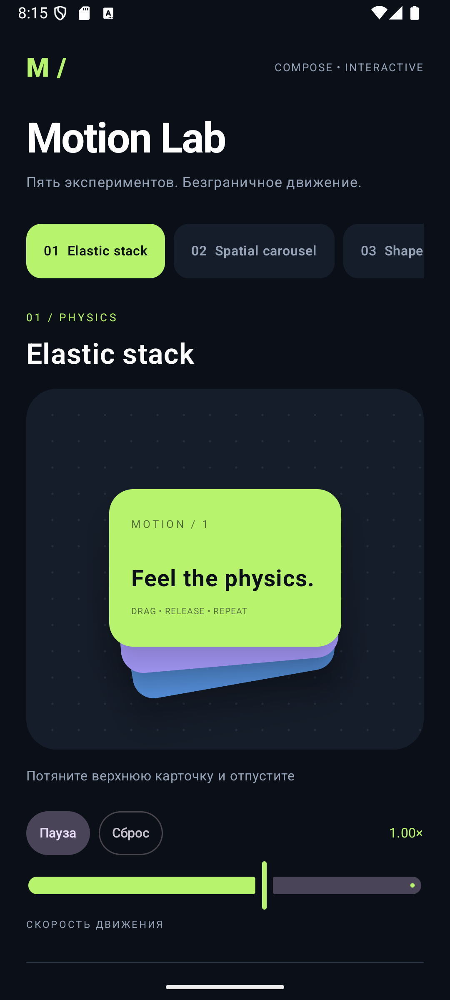

# Motion Lab

Демонстрационное Android-приложение на Jetpack Compose с пятью интерактивными анимациями. Проект показывает работу с кастомной отрисовкой, жестами, физикой движения, перспективой и координацией нескольких анимированных элементов.

## Демонстрации

| Сцена | Возможности | Техника |
| --- | --- | --- |
| **Elastic stack** | Перетаскивание стека карточек и упругий возврат | Три независимые пружины, разная жёсткость и затухание, наклон и смещение слоёв |
| **Spatial carousel** | Горизонтальное перелистывание с инерцией | Расположение по окружности, сортировка по глубине, масштаб, поворот по оси Y и фиксация с учётом скорости жеста |
| **Shape laboratory** | Превращение круга в звезду или органический контур | Интерполяция 240 точек, пружинное изменение формы, градиент и вращение |
| **Orbital field** | Перемещение центра касанием | 96 частиц в Canvas, индивидуальные фазы, следы, свечение и пружинное перемещение центра |
| **Radial bloom** | Раскрытие радиального меню и выбор акцента | Каскадное появление кнопок, независимые пружины, полярное размещение и расходящиеся кольца |

## Интерфейс

- Тёмная галерея с горизонтальным переключением сцен.
- Пауза и продолжение движения без скачка времени.
- Скорость от 0,25× до 1,5×.
- Сброс активной сцены в исходное состояние.
- Подсказки по взаимодействию и описание реализации каждой анимации.

Выбранная сцена, скорость и состояние паузы сохраняются при пересоздании Activity. Локальное состояние жестов и симуляций при этом сбрасывается. Во время паузы взаимодействие со сценами приостановлено.

## Видео демонстрации

[Посмотреть демонстрацию анимаций (MP4)](docs/motion-lab-demo.mp4)

Видео включено в репозиторий и показывает приложение в работе.

## Скриншот



## Технологии

- Kotlin, Jetpack Compose и Material 3.
- Compose BOM `2026.02.01`, Kotlin Compose Plugin `2.2.10`.
- Android Gradle Plugin `9.1.1`, Gradle Wrapper `9.3.1`.
- Минимальная версия Android: API 26; target SDK: 36; compile SDK: 36.1.
- JDK 21 для Gradle daemon.

Сцены создаются средствами Compose без сторонних библиотек анимации и готовых анимационных ассетов. Пружинный интегратор использует четыре подшага на кадр; общий кадровый таймер учитывает паузу и выбранную скорость.

## Запуск

1. Откройте корневую папку проекта в Android Studio.
2. Установите Android SDK Platform 36.1 и настройте Gradle JDK 21.
3. Выполните Gradle Sync.
4. Выберите эмулятор или устройство с Android API 26 и выше.
5. Запустите конфигурацию `app`.

При запуске через Android Studio приложение будет собрано и установлено на выбранное устройство. Локальные пути SDK хранятся в `local.properties`; этот файл не включается в репозиторий.

## Проверки

Проверка компиляции Kotlin без упаковки APK:

```powershell
./gradlew.bat compileDebugKotlin
```

Локальные JVM-тесты:

```powershell
./gradlew.bat testDebugUnitTest
```

Инструментальные тесты на подключённом устройстве или эмуляторе:

```powershell
./gradlew.bat connectedDebugAndroidTest
```

Последняя команда собирает и устанавливает тестовые APK. `MotionLabTest` проверяет открытие всех пяти сцен и сброс в режиме паузы. Автоматический тест не проверяет плавность анимаций и корректность всех жестов. Для оценки производительности нужны замеры на реальном устройстве.

На macOS/Linux используйте `./gradlew` вместо `./gradlew.bat`.

## Структура

```text
app/src/main/java/com/expertanimationexample/
├── MainActivity.kt       # Галерея, управление и кадровый таймер
├── MotionScenes.kt       # Пять сцен и пружинный интегратор
└── ui/theme/             # Ресурсы темы стартового проекта

app/src/androidTest/java/com/expertanimationexample/
└── MotionLabTest.kt      # Проверка навигации и сброса

gradle/libs.versions.toml # Версии зависимостей
```

Основная тема галереи задаётся в `MainActivity.kt`. Цвета, параметры пружин и геометрия сцен находятся в исходниках и могут использоваться как отправная точка для дальнейших экспериментов.
